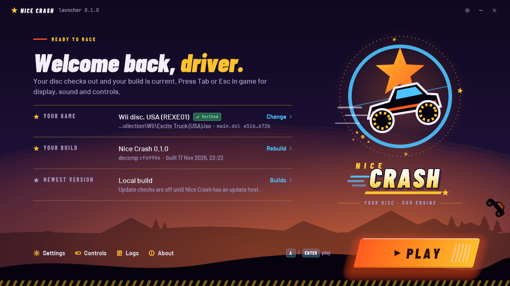
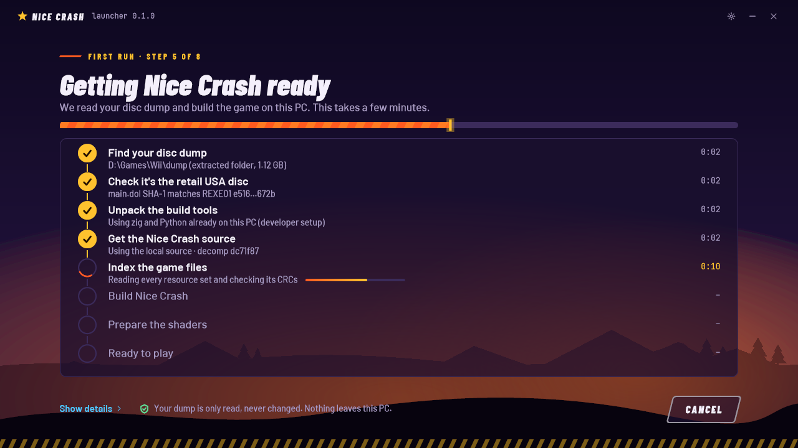
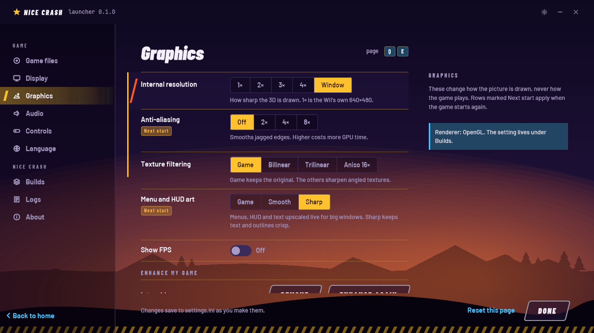
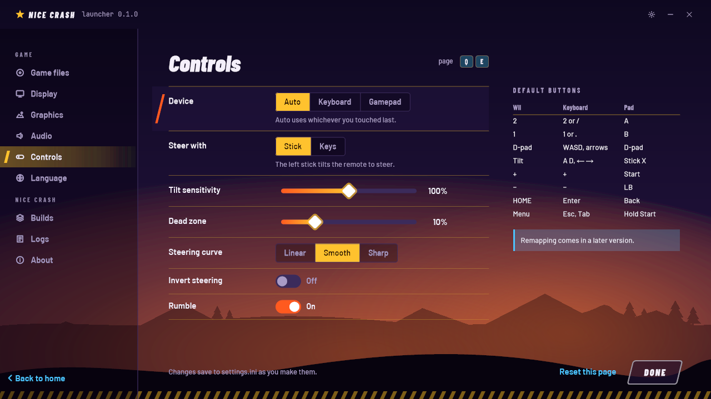

# Nice Crash

**An unofficial native PC port of Excite Truck (Wii), built from the
[matching decompilation](https://github.com/ablindingnight/excite-truck).**
Bring your own disc: **no game files are included**. Everything is read from your own copy at run time.

> Work in progress, an early preview. Not affiliated with or endorsed by Nintendo or Monster Games.

## How to play

**You need**
- your own **Excite Truck disc (USA, game ID REXE01)**, dumped from your Wii to a disc image (`.iso`, `.rvz`, `.wbfs`,
  `.wia`, `.gcz`, `.ciso`) or extracted with Dolphin (right-click the game > Properties > Filesystem > Extract Entire Disc).
  Other regions don't work yet;
- Windows 10 or 11 (64-bit) with any graphics card or laptop graphics from the last ten years (OpenGL 3.0);
- about 2 GB of free disk space;
- a game controller (Xbox-style) or the keyboard.

**First run** (5 to 15 minutes, once)
1. Download the latest zip from **[Releases](https://github.com/ablindingnight/nice-crash/releases)** and unzip it
   somewhere with a short path, e.g. `C:\Games\NiceCrash`.
2. Double-click **Start Nice Crash.cmd**. If Windows SmartScreen warns about an unrecognised app, click
   *More info* > *Run anyway*.
3. Drag your disc image (or extracted folder) onto the launcher, or pick it.
4. The launcher checks it's the retail USA disc, unpacks it and builds the game on your PC. Leave it open.

5. When it says **Ready to race**, press **PLAY**.

**Controls** (keyboard, Wii Remote held sideways): `2` accelerate, `1` brake, Left/Right or A/D steer, Up turbo,
Shift+Up/Down lean, Space = A, Enter = HOME menu. A gamepad works too, and everything can be changed in Settings.

| Graphics | Controls |
| --- | --- |
|  |  |

**If something goes wrong**: the launcher's **Logs** page lists every run, and *Save report* makes a folder with the log
and your settings (your user name is removed). Nothing is ever sent anywhere.

## Why the game is built on your PC
The download contains no Nintendo data. Some of the game's tables come from your own disc's `main.dol`, so the
launcher builds the game exe on your PC from the open source here plus your disc, with a bundled compiler. (Planned:
load those tables at run time instead, so a ready-made exe can ship and the first run takes seconds.)

## Licence
CC0 1.0 (public domain), the same as the decompilation. The launcher's art (star, tilt ring, truck) is our own.
Fonts: Barlow, Barlow Condensed and JetBrains Mono under the SIL Open Font License 1.1 (`assets/fonts`).

---

## For developers

### Build
`sh build.sh` (needs zig 0.17+; links only Windows system libraries).

### Use
`build/NiceCrash.exe` is the launcher: it finds your disc dump (or lets you pick it), checks it, indexes it with
the importer, builds the game when needed, holds the settings, and PLAY starts `build/NiceCrashGame.exe`.

- Settings: `%LOCALAPPDATA%\NiceCrash\settings.ini` (only values you changed; `lib/settings.cpp`).
  `NICECRASH_<SECTION>_<KEY>` environment variables override it (also `NICECRASH_ASPECT`, `NICECRASH_ERROR_LOG`).
- Logs: `%LOCALAPPDATA%\NiceCrash\logs\` (`nicecrash_log.txt` + 4 older runs when "Save error logs" is on, and
  `runs.tsv`, the last 10 runs).
- Debugging: `NiceCrash --ui-shot <home|disc|firstrun|settings:<page>> out.bmp [w h]` renders a screen;
  `NiceCrash --launch-game [s]` starts the game as PLAY does; `NICECRASH_GAME_EXE` and `NICECRASH_SETTINGS_FILE`
  point at another game exe or settings file.

By hand: `build/import.exe "<your extracted disc folder>"` verifies the dump (main.dol SHA-1) and indexes its
resource sets into `%LOCALAPPDATA%\NiceCrash\dump.ini`. `build/NiceCrash.exe --viewer` is the phase-0 viewer (the
boot logo from your disc); options `--tex set.res/name.tex`, `--screenshot out.bmp`, `--scan`, `--disc`, `--dol`.

### Layout
- `lib/` shared code ported from the decomp: resource loader (res.cpp), textures (texture.cpp, drtex.cpp),
  CRC (crc.cpp), dump verification, config. Renaming the project: `lib/project.h`.
- `tools/import/` dump importer. `host/src/launcher/` the launcher (GDI+); `host/src/viewer.cpp` phase-0 viewer.
- `docs/` BOOT_PATH.md, ROUTE.md, PROGRESS.md.
